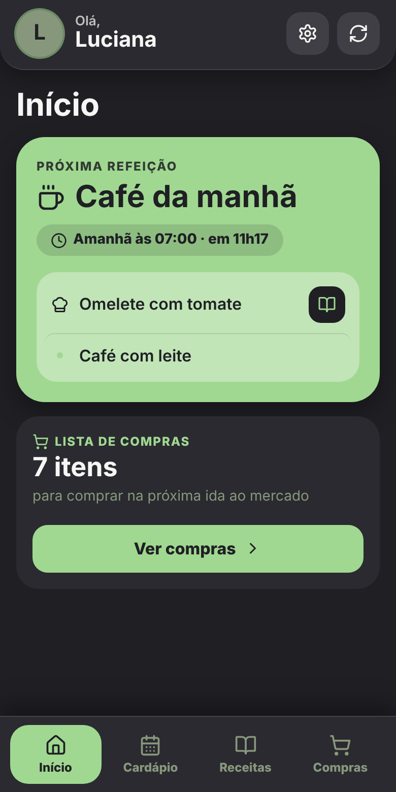
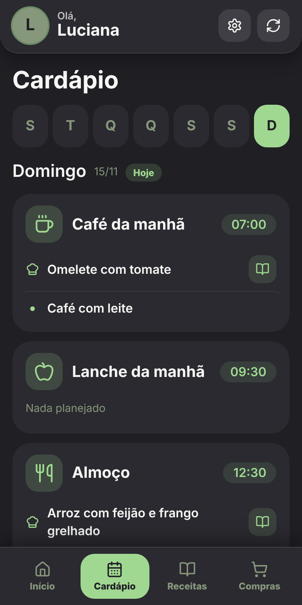
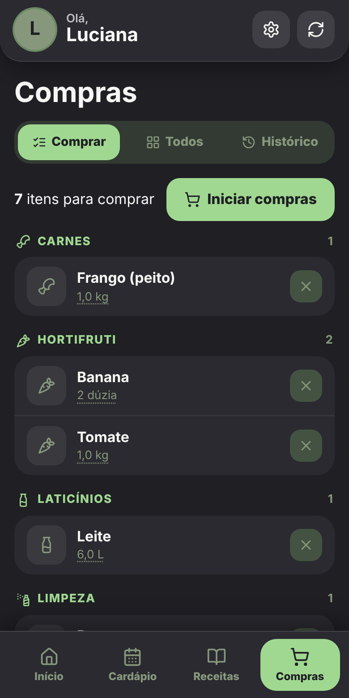
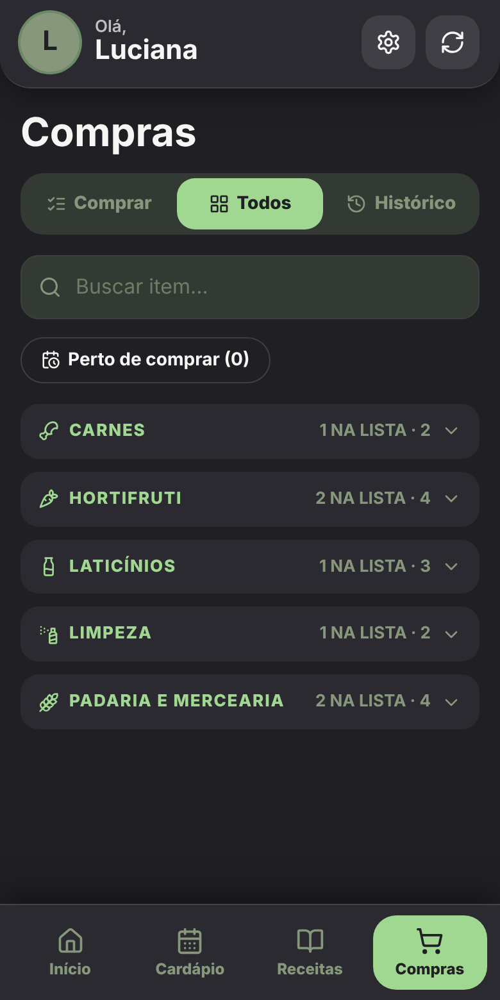
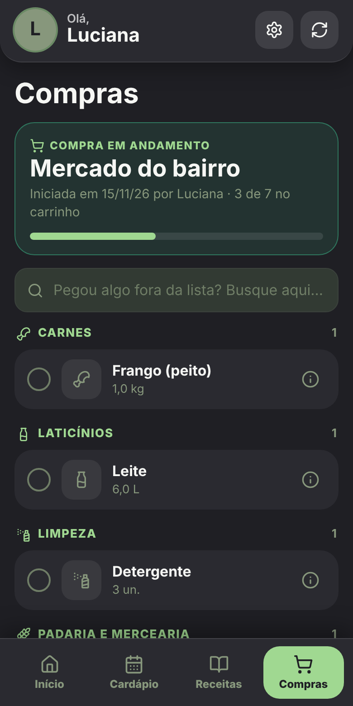
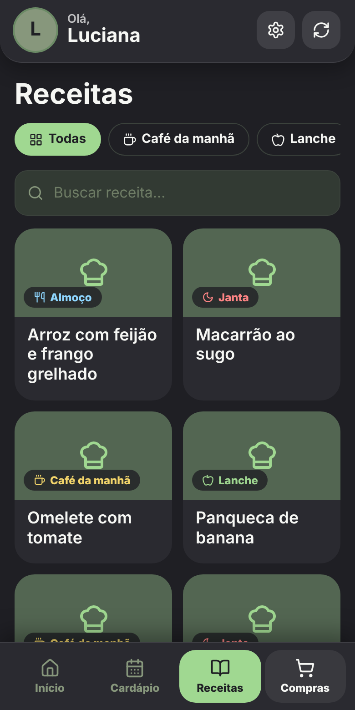
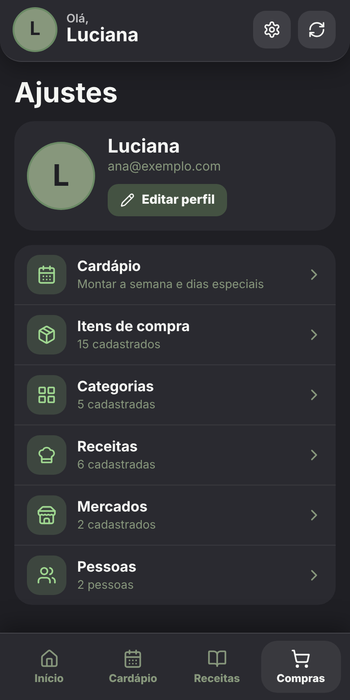
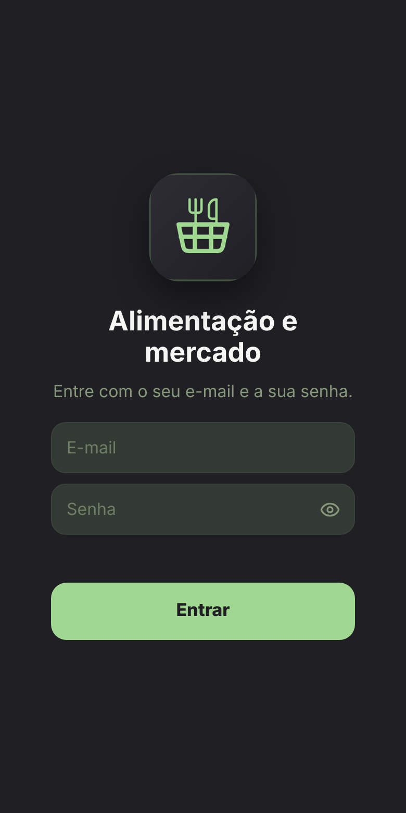

# Alimentação e mercado

Um app simples para organizar a comida da casa: **o cardápio da semana, as receitas e a lista de compras**, tudo num só lugar e compartilhado entre as pessoas da família.

Funciona como um aplicativo instalável no celular (PWA), hospedado no GitHub Pages. Os dados ficam numa planilha do Google Sheets, e o Google Apps Script faz a ligação entre o app e a planilha. O acesso é privado: só entra quem tem e-mail e senha cadastrados.

## O que ele faz

- **Início:** mostra a próxima refeição e quantos itens faltam comprar.
- **Cardápio:** planejamento da semana, com café, lanches, almoço e janta de cada dia. Cada refeição pode ter receitas e alimentos soltos.
- **Compras:** a lista do que falta, com o catálogo completo de itens organizado por categoria. Ao ir ao mercado, é só iniciar a compra e marcar o que entrou no carrinho. O app mostra a quantidade de cada item e guarda o histórico de gastos.
- **Receitas:** cadastro de receitas, para usar no cardápio.
- **Ajustes:** itens, categorias, mercados, pessoas e perfil. As listas de opções (tipos de receita, embalagens, medidas) são editadas direto na planilha.

Ele também funciona em duas ou mais pessoas ao mesmo tempo: quem marca um item no mercado atualiza a lista para todos.

## Telas

| Início | Cardápio | Compras |
|:--:|:--:|:--:|
|  |  |  |

| Todos os itens | Compra em andamento | Receitas |
|:--:|:--:|:--:|
|  |  |  |

| Ajustes | Login |
|:--:|:--:|
|  |  |

## Como é feito

```
Celular (este site, no GitHub Pages)  →  Apps Script (API com login)  →  Planilha Google
```

- `index.html`: o app inteiro (telas e lógica).
- `config.js`: o endereço do Apps Script.
- `manifest.json`, `sw.js` e `icons/`: tornam o site instalável no celular.
- `apps-script/`: o código que roda dentro da planilha (3 arquivos).

Para configurar do zero, veja o passo a passo em [LEIA-ME.md](LEIA-ME.md).

*As telas acima usam dados de exemplo.*
